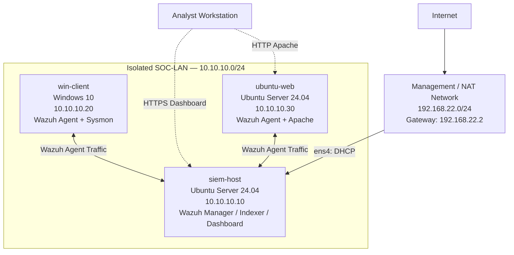

# Mini-SOC Network Topology

## Wazuh Mini-SOC — Week 1

## Network Security

- Only siem-host has a permanent NAT connection.
- win-client and ubuntu-web have no default IPv4 routes.
- Wazuh agents communicate through the internal SOC-LAN.
- The SIEM host uses a separate interface for management connectivity.
- The environment runs inside PNETLab on VMware Workstation.

## Related Documentation

See [Network Addressing](addressing.md) for detailed IP configurations and connectivity verification.
